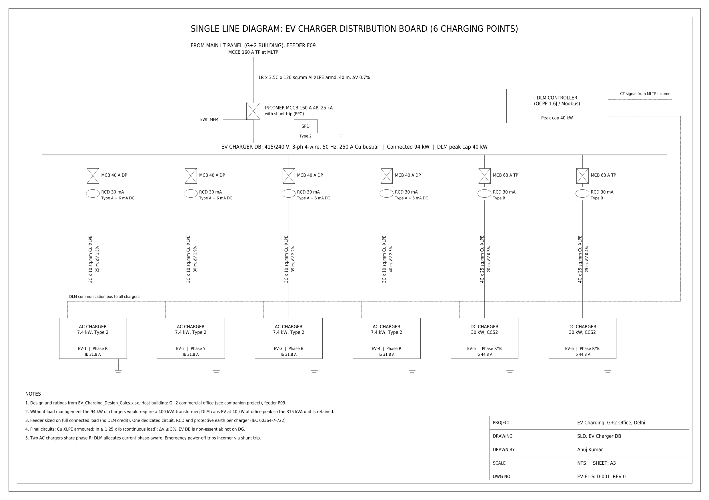

# EV Charging Infrastructure Design: Commercial Office Building

Design of 6 EV charging points for the parking of a 1,800 m² commercial office in Delhi: charger selection, the transformer impact with and without **dynamic load management (DLM)**, an hourly DLM profile, the EV distribution board, the final circuits, and **AC vs DC pricing with payback**.

This project **connects to my G+2 building design**: [building-electrical-design-g2](https://github.com/ajkumar-1907/building-electrical-design-g2). The EV distribution board is fed from that building's Main LT Panel (feeder F09) and shares its 315 kVA transformer. The host-building inputs in this workbook come from that project's Rev 0, so the two can be read together or separately.

## Design summary

| Item | Result |
|---|---|
| Charging points | 6 = 30 parking spaces × 20% EV-ready (MoHUA Model Building Bye-Laws, 2019 amendment) |
| Chargers | 4 × 7.4 kW AC (Type 2, single-phase, 32 A) + 2 × 30 kW DC (CCS2, three-phase) |
| Connected EV load | 94 kW |
| Without load management | Building MD 261 kVA, so a **400 kVA** transformer would be needed |
| With DLM (peak cap 40 kW) | Building MD 208 kVA, so the existing **315 kVA** transformer is retained |
| Peak share per charger | About 6.7 kW each with all 6 in use; full power outside office hours |
| Daily energy check | 729 kWh deliverable in the 8 AM–8 PM window vs 240 kWh needed (3× margin) |
| Feeder MLTP → EV DB | MCCB 160 A, 1R × 3.5C × 120 mm² Al XLPE, 40 m, ΔV 0.7% (sized on full load, no DLM credit) |
| AC final circuits | 40 A MCB DP, RCD 30 mA Type A + 6 mA DC detection, 3C × 10 mm² Cu, ΔV ≤ 2.5% |
| DC final circuits | 63 A MCB TP, RCD 30 mA Type B, 4C × 25 mm² Cu, ΔV ≤ 0.5% |
| User price (incl. GST) | AC ₹7.3–11.8/kWh, DC ₹16.9–22.7/kWh (solar / non-solar hours) |
| Payback | About 4.4 years for the whole station (AC 4.6, DC 4.4) |

## Pricing: why DC costs more

The EV DB is sub-metered behind the building's HT connection, as the Ministry of Power's 2024 guidelines allow. That means a **single-part EV tariff with no demand charge**. The price to the user is:

**Price = (EV tariff × time-of-day multiplier ÷ charger efficiency + service charge) × 1.18 GST**

| ₹ per kWh | AC 7.4 kW | DC 30 kW |
|---|---|---|
| Energy pass-through, solar hours (9 AM–4 PM, 0.7×) | 3.21 | 3.35 |
| Energy pass-through, non-solar hours (1.3×) | 5.97 | 6.22 |
| Service charge (MoP ceiling) | 3 / 4 | 11 / 13 |
| **User price, solar hours** | **7.33** | **16.93** |
| **User price, non-solar hours** | **11.76** | **22.68** |
| 20 kWh session | ₹147–235, about 2.7 h | ₹339–454, about 0.7 h |

- **The DC premium is about 124%.** It pays for the faster service and a charger that costs roughly 10× more (about ₹7 L vs ₹0.7 L installed). It stays within the MoP service-charge ceilings.
- **Idle fee:** ₹5/min on DC bays after a 15-minute grace period, to free the fast charger. This isn't counted as revenue.
- **Revenue and payback:** 12 sessions/day × 20 kWh × 300 days. Service revenue is ₹1.2 L/yr (AC) and ₹4.4 L/yr (DC). After O&M and software fees, payback is about 4.4 years.
- **Design finding:** the cheapest solar hours (9 AM–4 PM) overlap the office peak, when DLM limits EV power to 40 kW. So DLM gives long-dwell AC charging priority in the day, and the DC bays work best before 10 AM and after 5 PM.

## How the DLM cap is set

1. **Design limit on the existing transformer:** 315 kVA × 0.8 loading ÷ 1.2 future margin = 210 kVA.
2. **Building MD without EV:** 170 kVA (from the G+2 load schedule), which leaves about 40 kVA of headroom.
3. **Largest EV load that fits at the office peak:** 44.6 kW. Rounded down, the **DLM cap is 40 kW**.
4. **Hourly check:** with a typical office load profile, EV power available is 45 kW from 10 AM to 5 PM and rises to the full 94 kW before 9 AM and after 6 PM.

EV load is **not diversified**: under DLM it is a controlled, firm load.

## Repository contents

| File | What it is |
|---|---|
| `calcs/EV_Charging_Design_Calcs.xlsx` | Calculation workbook with live formulas |
| `drawings/EV-EL-SLD-001.pdf` | SLD of the EV charger DB, A3 |
| `drawings/EV-EL-SLD-001.dxf` | Same SLD, editable in AutoCAD |
| `drawings/EV-EL-SLD-001.png` | Preview image |

### Workbook sheets

1. **Inputs**: host-building demand, transformer, charging-use assumptions, derating
2. **Chargers**: parking requirement, charger schedule, phase allocation
3. **Transformer_Impact**: building MD with and without DLM, peak cap
4. **Hourly_DLM**: 24-hour office profile, EV power available each hour, daily energy check, chart
5. **Cables**: MLTP → EV DB feeder and one final circuit per charger
6. **Pricing**: AC vs DC user price, revenue and payback
7. **Ref_Tables**: Havells cable data, standard ratings

## Using it with another building

Change the host-building inputs on the **Inputs** sheet (non-EV demand, transformer rating, margins) and the cap, feeder and checks all recalculate.

## Standards and sources

- IEC 61851-1 / -23 and IS 17017 (EV conductive charging); IEC 60364-7-722 (supplies for electric vehicles); IS 732; IEC 60364-5-52
- MoHUA Model Building Bye-Laws 2016, amendment for EV charging infrastructure (2019)
- Ministry of Power, Guidelines for Installation and Operation of EV Charging Infrastructure (2024): tariff 0.7× / 1.3× average cost of supply in solar / non-solar hours; service-charge ceilings AC ₹3 / ₹4 and DC ₹11 / ₹13 per kWh until March 2028 ([Mercom](https://www.mercomindia.com/ministry-of-power-releases-ev-charging-infrastructure-guidelines), [Autocar Pro](https://www.autocarpro.in/news/ministry-of-power-revises-guidelines-for-ev-fast-charging-122714))
- DERC EV charging tariff ₹4.5/kWh LT ([Mercom, 2019](https://www.mercomindia.com/delhi-tariffs-ev-charging-electric-mobility))
- Havells International Cables catalogue (Tables 16 and 20)

## Limitations

- Parking count (30), daily sessions (12) and energy per session (20 kWh) are assumptions
- The office load profile is typical, not measured
- The DLM cap uses a unity-PF approximation for EV load; the MD checks use the full kW/kVAr sum
- Two AC chargers share phase R (+16% on that phase); DLM must be phase-aware
- RCD type and harmonic limits to be confirmed with the charger manufacturer
- Delhi EV tariff is from the 2019 DERC order (check the current DISCOM schedule); charger costs, O&M and usage are approximate

## Author

**Anuj Kumar**, B.Tech Electrical Engineering, Delhi Technological University (2027)
